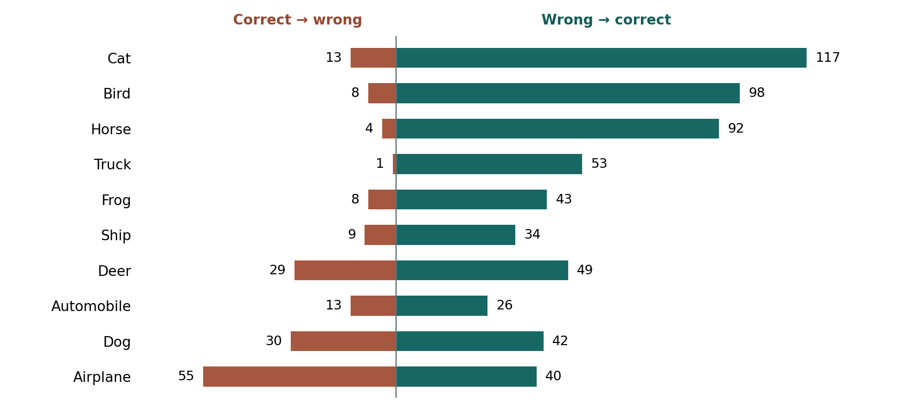

# CIFAR-10 image classification | CNN and ResNet18

How well does a compact CNN trained from scratch compare with an ImageNet-pretrained ResNet18 on CIFAR-10? This PyTorch project trains three classifiers on the same image IDs and tracks which predictions change when the final residual stage is fine-tuned.

## Results

| Model | Selected epoch within stage | Validation accuracy | Test accuracy | Test macro-F1 |
| --- | ---: | ---: | ---: | ---: |
| Three-block CNN | 10 | 70.44% | 69.57% | 0.6891 |
| ResNet18, frozen encoder | 7 | 87.40% | 85.68% | 0.8565 |
| ResNet18, final stage and classifier fine-tuned | 3 | 90.74% | **89.92%** | **0.8991** |

On the 10,000 test images, fine-tuning corrected **594** frozen-model errors and introduced **170**, a net gain of **4.24 percentage points**. Cats had the largest net gain, with 104 additional correct predictions out of 1,000. Cat-to-dog errors fell from 131 to 77, while dog-to-cat errors rose from 80 to 90. [Test predictions](results/test/test_predictions.csv) · [Class metrics](results/test/test_per_class.csv) · [Confusion matrices](results/test/test_confusions.png)



The runs use one seed. Architecture, input resolution, pretraining and training schedule all differ between the CNN and ResNet18. The tuned model also received three more epochs after the selected frozen checkpoint, so the comparison includes the effect of extra training.

## Quick start

From the repository root with Python 3.10+ in a virtual environment, install the package and run the offline audit. The audit alone also works with a standard Python installation.

```bash
python -m pip install -e ".[dev]"
python scripts/verify_results.py
```

To train all three models, run the commands below. The first run downloads CIFAR-10 and the frozen stage fetches ImageNet weights. Training uses CUDA when available. Use `--device cpu` to select CPU or install the corresponding CUDA build for your hardware. [PyTorch installation options](https://pytorch.org/get-started/locally/)

```bash
cifar10-train cnn --run-dir runs/cnn
cifar10-train frozen --run-dir runs/frozen
cifar10-train tuned --parent runs/frozen/best.pt --run-dir runs/tuned
```

Each run writes the selected weights (`best.pt`), resumable state (`last.pt`), an epoch history and a learning curve. To resume training, repeat its command with `--resume`. The `--epochs` value includes completed epochs.

### Evaluate checkpoints

Evaluate validation first. The test command matches checkpoint hashes and replays two validation images per class before loading the official test set. Both commands require a fresh output directory and produce per-image predictions, summary metrics and figures.

```bash
cifar10-evaluate --split validation --cnn runs/cnn/best.pt --frozen runs/frozen/best.pt --tuned runs/tuned/best.pt --output runs/validation
cifar10-evaluate --split test --cnn runs/cnn/best.pt --frozen runs/frozen/best.pt --tuned runs/tuned/best.pt --validation runs/validation --output runs/test
```

## Experimental protocol

The official training partition is split into 45,000 training and 5,000 validation images, stratified by class with seed 42. All models use cross-entropy, Adam and a batch size of 128. Selection minimises validation cross-entropy, keeping the earlier epoch on ties. Training applies random padded crops and horizontal flips at native resolution before model-specific preprocessing. [Learning curves](results/training/learning_curves.png)

| Setting | Custom CNN | Frozen ResNet18 | Fine-tuned ResNet18 |
| --- | --- | --- | --- |
| Input | 32 × 32, normalized with training-only RGB statistics | Resize to 256, center crop to 224, ImageNet normalization | Same as frozen model |
| Trainable weights | Three convolutional blocks and classifier (94,762 parameters) | Linear classifier (5,130 parameters) | Final residual stage and classifier |
| Learning rate | 0.001 | 0.001 | 0.00001 for the final stage, 0.0001 for the classifier |
| Training budget | 10 epochs | 10 epochs | 3 additional epochs, with the frozen parent eligible at epoch 0 |

Encoder BatchNorm running statistics stay fixed in both ResNet18 stages. The pretrained weights are torchvision's `IMAGENET1K_V1`. [CIFAR-10 dataset](https://www.cs.toronto.edu/~kriz/cifar.html) · [ResNet architecture](https://arxiv.org/abs/1512.03385) · [ResNet18 weights](https://docs.pytorch.org/vision/stable/models/generated/torchvision.models.resnet18.html)

### Augmentation ablation

Removing crop and flip changed CNN validation accuracy from **70.44% to 70.46%**. The augmented model alone classified 444 images correctly, and the unaugmented model alone classified 445 correctly. The near-identical totals mask different errors. [Recorded comparison](results/augmentation/augmentation_comparison.csv)

```bash
cifar10-train cnn --no-augmentation --run-dir runs/cnn-no-aug
cifar10-evaluate --cnn runs/cnn-no-aug/best.pt --output runs/validation-no-aug
```

## Reproducibility

```bash
python -m pytest -q
ruff check .
cifar10-paired-errors --output runs/paired_changes.png
```

The tests exercise data splits, checkpoint recovery and validation-before-test evaluation on CPU. The audit recomputes accuracy, macro-F1, confusion counts and paired errors, verifies the recorded prediction digest and checks selected epochs against the histories. The paired-error command regenerates the class-level figure and a class-stratified bootstrap interval.

| Path | Contents |
| --- | --- |
| [cifar10/](cifar10) | Models, data, training, checkpoint loading, evaluation and plotting |
| [results/training/](results/training) | Recorded epoch histories and learning curves |
| [results/validation/](results/validation) · [results/test/](results/test) | Image-level predictions and aggregate metrics |
| [protocol.json](results/test/protocol.json) | Original checkpoint hashes, preprocessing, software versions and evaluation settings |
| [scripts/verify_results.py](scripts/verify_results.py) · [tests/](tests) | Independent results audit and offline tests |

Replaying the exact recorded networks requires the original checkpoints. The evaluator accepts the original training archives or newly trained checkpoints. The published predictions can be audited independently of the weights.
